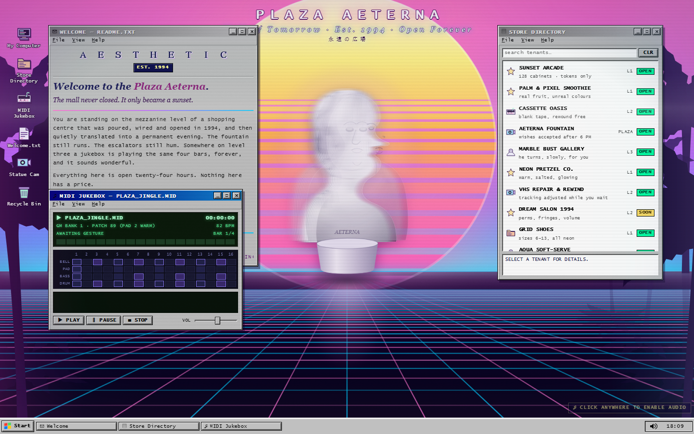
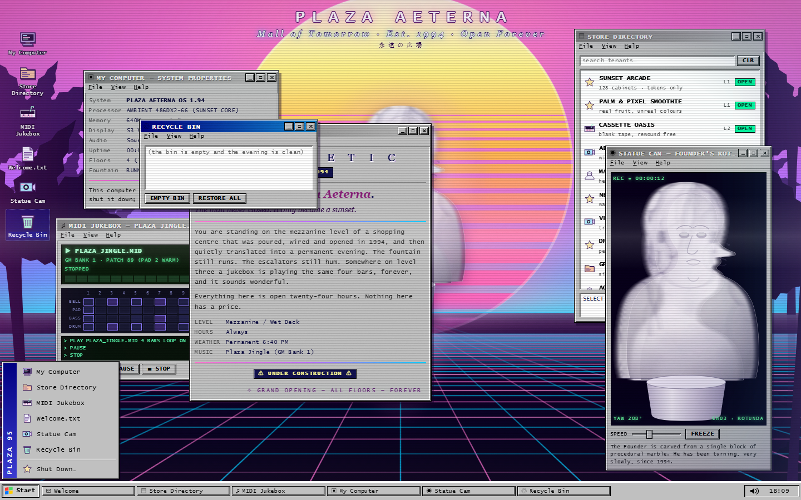
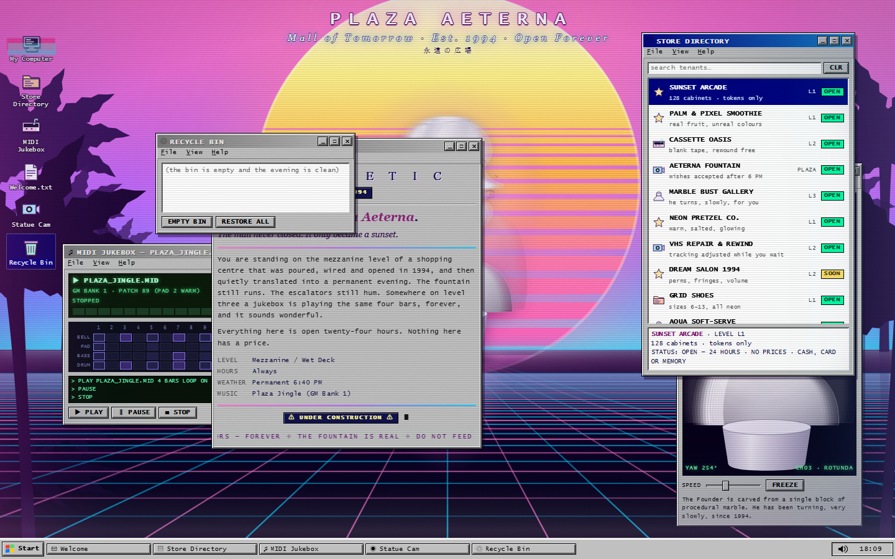
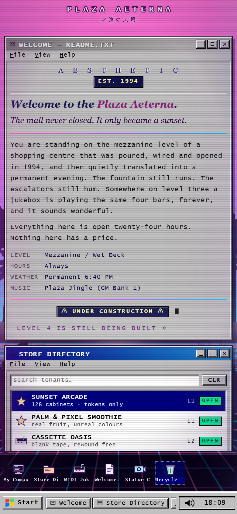
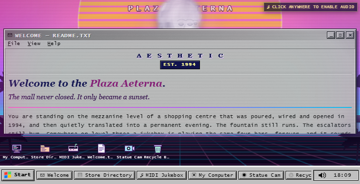

# PLAZA AETERNA — Mall of Tomorrow (Est. 1994)

A **single HTML file**, zero-dependency, zero-network vaporwave dreamscape. Open it and the mall is already open, the sun is already setting, and the marble bust has been turning, very slowly, since 1994.

- **Live**: `https://daoge96.github.io/plaza-aeterna/`
- **Local**: download `index.html`, double-click it. No build, no server, no requests — it works offline from `file://`.
- **84 KB · one file · 0 external resources · 0 dependencies.**

中文：单文件零依赖的蒸汽波梦境。夕阳、条纹太阳、霓虹透视网格、棕榈剪影、程序化大理石胸像，以及一层可拖拽的 Windows 95 窗口（商店目录 / MIDI 播放器 / 欢迎信）。手机端自动变成纵向堆叠卡片。

---

## Scene

Everything you can see is generated at runtime — the marble, the palms, the sun's stripes, the film grain, the reverb impulse, every sound.

- Sunset gradient `#ff71ce → #b967ff → #01cdfe` (horizon at 62.5%).
- **Striped retro sun** — SVG disc with a procedurally built stripe mask, stripes widening toward the base.
- **Neon perspective grid floor**, scrolling toward the viewer: `y = hy + bot·NREF/n`, with `n` decreasing over time, verticals converging on a single vanishing point.
- **Palm silhouettes** — trunks and arching, serrated fronds integrated along a curving spine from a seeded PRNG; foreground palms sit in front of the grid with a reflection.
- **Marble bust** — 13 front + 13 profile SVG slices, depth-sorted twice per revolution and cross-faded by `|cos θ|^1.35`, so it reads as a solid turning head rather than a spinning card. The veining is a **procedurally generated** marble texture: seeded wandering strands with recursive branches, capillaries and speckle, rendered to a canvas and baked into an SVG `<pattern>`.
- CRT power-on, scanlines, a rolling band, animated grain, chromatic edges, vignette.

## Desktop

`#c0c0c0` bevels, navy `#000080` title bars, `_ □ ×` buttons, File/View/Help menus.

| Window | What it does |
| --- | --- |
| Welcome | Full-width `Ａ Ｅ Ｓ Ｔ Ｈ Ｅ Ｔ Ｉ Ｃ`, serif italic, ticker |
| Store Directory | 15 tenants, pastel SVG icons, live search, detail pane |
| MIDI Jukebox | Real Web Audio synth — Fmaj9 → Dm9 → BbMaj7 → Cadd9, 4-bar loop, 16-step tracker, VU meter |
| My Computer | System properties + uptime |
| Statue Cam | Live `<use>` view of the bust, yaw readout, speed slider |
| Recycle Bin | Empty / restore |

Drag by the title bar, minimise to the taskbar (Start button, live clock, tray), maximise, close. Desktop icons and Start-menu entries open windows.

## Sound

Audio unlocks on your first gesture, then a lookahead scheduler renders a pad, bell arpeggio, bass, kick / snare / hat and vinyl hiss through a procedurally generated convolution reverb and a 5.2 kHz lo-fi lowpass. There is no audio file anywhere.

## Interaction

Hovering any interactive element fires a VHS glitch: a per-element RGB tear plus a global horizontal-tracking displacement filter (`feTurbulence` with zero X frequency → row-wise tearing). Ambient tracking bursts fire on their own every few seconds.

## Responsive

At ≤720 px wide **or** ≤540 px tall — so landscape phones too — windows become single-column stacked cards, desktop icons become a bottom strip, and dragging is disabled. Verified with no horizontal overflow from 320×568 to 1920×1080.

## Accessibility

Real `<button>` icons, keyboard activation on every custom widget, a complete listbox contract on the directory (roving tabindex, arrows, Home/End, Space/Enter, `aria-selected`), aria labels on all window controls, visible focus rings, text that clears WCAG AA against its *measured* animated backdrop, and `prefers-reduced-motion` that freezes the grid, the rotation, the marquee and the flicker.

---

## Verify it

Not "looks like it runs" — automated, headless, and adversarial.

```bash
node dev/plaza-verify.js     # 95 assertions: scene geometry, drag, minimise, audio graph, glitch, listbox a11y, contrast, responsive, console hygiene
node dev/plaza-probe4.js     # 10 viewport sizes (320 → 1920, incl. the 721px breakpoint edge and 740×380 landscape): overflow/overlap matrix
node dev/plaza-perf.js       # frame cadence + DOM/heap budget under load
node dev/plaza-probe3.js     # bust opacity vs a hidden backdrop, at four rotation angles
node dev/plaza-probe5.js     # scene geometry + proof the VHS filter actually computes
```

`dev/audit-*.js` are independent adversarial probes written by a separate auditor agent: breakpoint matrix, icon hit-map, contrast and listbox semantics, a model-warped correlation test for the grid scroll direction, and reduced-motion deltas.

```bash
# if Chrome is behind the DSH sandbox, these flags are required
CHROME="/c/Program Files/Google/Chrome/Application/chrome.exe"   # or set $env:CHROME
```

### Results at the audited revision

| Suite | Result |
| --- | --- |
| `plaza-verify.js` | **95 / 95 pass**, 0 console errors, 0 warnings |
| `plaza-probe4.js` | all 10 sizes clean, `scrollWidth === innerWidth` everywhere |
| grid scroll direction | model-warped correlation picks *toward viewer* at dt = 500 / 900 / 1300 ms |
| bust opacity | within 1–3 / 255 of an identical backdrop at 0°, 34°, 65°, 90° — i.e. opaque |
| reduced motion | θ delta 0.00000 rad over 1.2 s; grid profile unchanged |
| perf | ~6 ms/frame free-running at 1440×900, 915 DOM nodes, 10 MB heap |

Two defects the audit caught, both fixed and now regression-tested:

1. A boot animation using `animation-fill-mode: forwards` permanently outranked the `#scene.vhs` rule, so **the global VHS tracking filter never applied at all** — only the per-element tear worked.
2. Window positions clamped inward on any resize while the card layout was active never came back, so shrinking the viewport and growing it again buried the icon column and made all six icons unclickable.

## Screenshots

| | |
| --- | --- |
|  |  |
|  |  |
|  |  |

## Notes

- The marble texture is generated at load (≈500 KB as a data URL) rather than shipped, which is why the file is only 84 KB.
- Chrome needs `--no-sandbox --disable-breakpad` when launched from inside the DSH sandbox (its mojo named pipes are otherwise blocked).
- MIT licensed.

---

祝你在广场玩得开心——这里的灯永远不会关。
